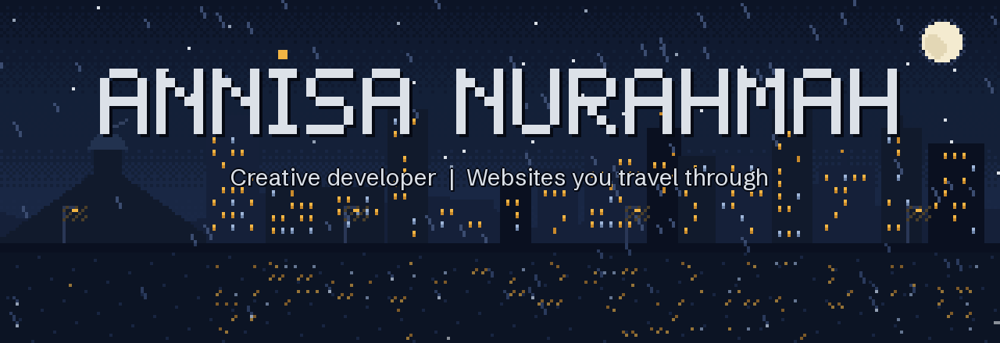
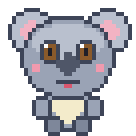
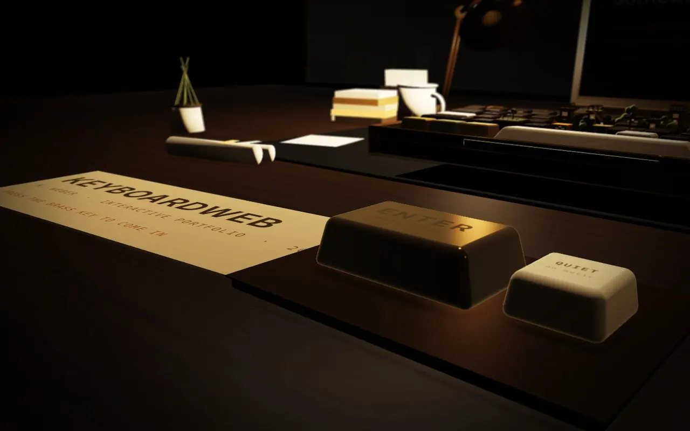
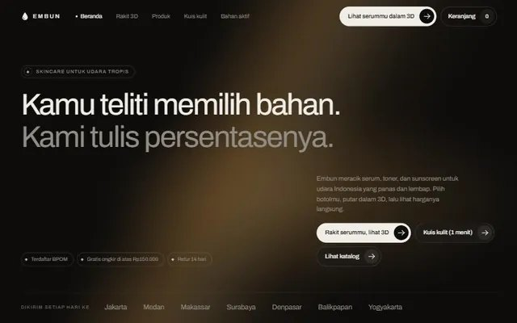
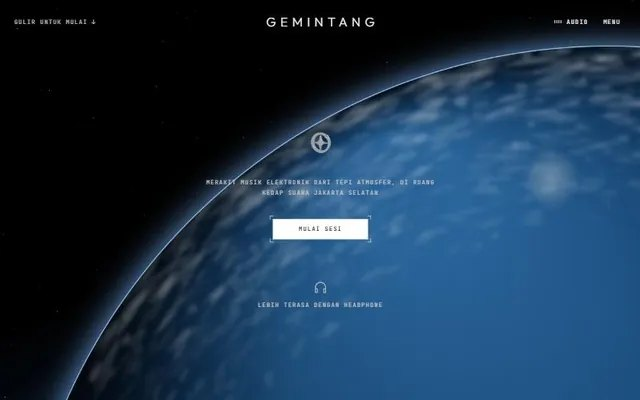
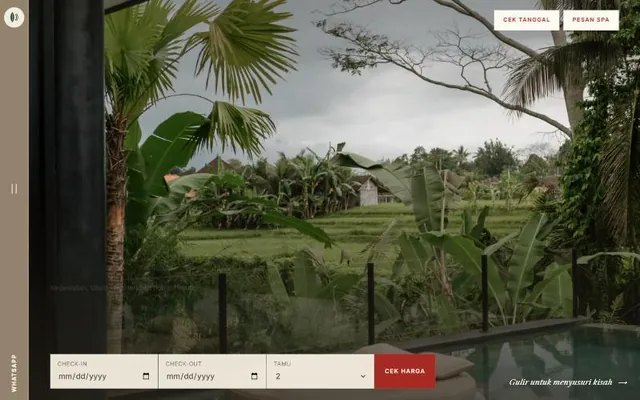
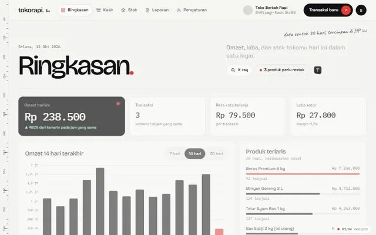

  

<!-- Tombol kontak: isi link kamu, lalu hapus tanda komentar pembuka & penutup di blok ini.

  
  
  
  

-->

## About me 

Hi, I'm **Annisa**, a creative developer from Indonesia. I make websites that behave like places, where the interface is something you explore instead of just scroll.

Most of my work starts in **Blender**, where I model scenes by script so they can be rebuilt and tuned, and ends in the browser with **three.js**, **GLSL** and **TypeScript**. I also build the practical side: shops, booking engines and dashboards with **Next.js**.

**Open for:** freelance projects and studio roles.

## Selected work

<table>
  <tr>
    <td width="100%" valign="top" colspan="2">
      
       <b><a href="https://github.com/annisanurahma/keyboardweb">KeyboardWeb</a></b> 
      A desk at night where every key is a door into a miniature world. It runs on a small WebGL2 engine I wrote for it, with zero runtime dependencies. 
      <code>WebGL2</code> · <code>custom engine</code> · <code>Blender</code>
    </td>
  </tr>
  <tr>
    <td width="50%" valign="top">
      
       <b><a href="https://github.com/annisanurahma/embun-skincare">Embun Skincare</a></b> 
      A skincare shop with a 3D glass serum bottle you can configure, a skin-type quiz, variants with stock, checkout with regional shipping and an admin dashboard. 
      <code>Next.js</code> · <code>three.js</code> · <code>37 tests</code>
    </td>
    <td width="50%" valign="top">
      
       <b><a href="https://github.com/annisanurahma/gemintang">Gemintang</a></b> 
      An electronic music studio seen from orbit. The satellite's solar panels react to the audio, and a 16-step drum machine synthesises every sound in the browser. 
      <code>Canvas 2D</code> · <code>Web Audio API</code> · <code>GSAP</code>
    </td>
  </tr>
  <tr>
    <td width="50%" valign="top">
      
       <b><a href="https://github.com/annisanurahma/villa-sabda">Villa Sabda</a></b> 
      A villa site with a real booking engine: an availability calendar, server-side pricing by season and weekend, protection against double booking and an admin dashboard. 
      <code>Next.js</code> · <code>REST API</code> · <code>54 tests</code>
    </td>
    <td width="50%" valign="top">
      
       <b><a href="https://github.com/annisanurahma/tokorapi">TokoRapi</a></b> 
      Point of sale and stock for a small shop: owner and cashier roles, a cashier screen, shifts, stock and reports, with 92 days of sample history. 
      <code>Next.js</code> · <code>auth & roles</code> · <code>reports</code>
    </td>
  </tr>
</table>

Also: [campus-space](https://github.com/annisanurahma/campus-space), a campus room booking system with React and Spring Boot microservices.

## Toolbox

`three.js` · `WebGL2 / GLSL` · `TypeScript` · `GSAP` · `Web Audio` · `Blender (Python)` · `Next.js` · `Node.js` · `Playwright` · `Laravel` · `Flutter`
